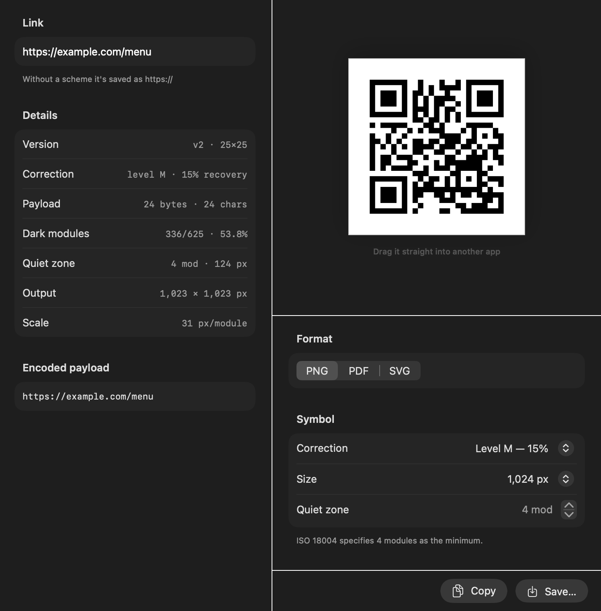
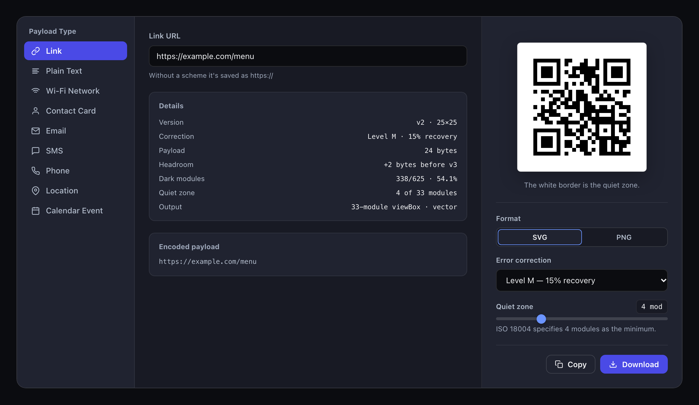

# Quick QR

A QR code generator for macOS and the browser. Pick a payload type, fill in the
fields, and export a code as SVG, PDF, or PNG.

[**Download for macOS**](assets/Quick-QR-macOS.zip) ·
[**Product page**](https://quick-qr-nu-rouge.vercel.app/) ·
[**Web studio**](https://quick-qr-nu-rouge.vercel.app/#studio) ·
[**Source on GitHub**](https://github.com/Ajtn05/Quick-QR)

<p align="center">
  
</p>

## Two ways to use it

| | Mac app | Web studio |
|---|---|---|
| **Formats** | PNG, SVG, PDF | PNG, SVG |
| **Batch export** | One file per line | Filename preview |
| **Details panel** | Version, modules, capacity, payload | Live inspector |
| **Runs** | Offline | In the browser, nothing uploaded |
| **Requires** | Apple Silicon, macOS 13 or later | A modern browser |

The Mac app adds PDF export, drag-to-export, batch files, and keyboard
shortcuts. The web studio covers the common cases without an install.

## Mac app

Build it with the Xcode Command Line Tools — there is no Xcode project:

```sh
git clone https://github.com/Ajtn05/Quick-QR.git
cd Quick-QR
./build.sh
open "build/QR Generator.app"
```

`build.sh` compiles the Swift sources in `Sources/` into an app bundle in
`build/`. Pass `--icon` to redraw the icon from `Tools/MakeIcon.swift`.

### Payload types

Link · Plain Text · Wi-Fi Network · Contact Card (vCard) · Email · SMS · Phone ·
Location · Calendar Event

Links typed without a scheme are saved as `https://`. Wi-Fi and vCard fields are
escaped per spec, so semicolons and commas in a network name or company name
survive the round trip.

### Export

- **SVG and PDF** for print, **PNG** for screens
- **Drag** the preview into Finder, Mail, Slack, or Figma; it writes a file in
  the selected format
- **Save…** (`⌘S`) remembers the last folder and names the file from its
  contents (`example-com.pdf`, `ada-lovelace.png`)
- **Copy** (`⇧⌘C`) puts an image, a PDF, or the SVG source on the clipboard
- **Batch Export…** (`⇧⌘B`) turns a pasted list into one file per line,
  deduplicating names that collide
- **Error correction** L/M/Q/H, with the ISO 18004 recovery percentage shown
- **Quiet zone** from 0 to 16 modules; the app warns below the four-module
  minimum

If the clipboard holds a URL when the app opens, it is prefilled.

### Details

The **Details** section reports symbol version and module count, correction
level and recovery percentage, payload size in bytes and characters, remaining
capacity before the symbol steps up a version, dark module count and density,
quiet zone in modules and pixels, and the output dimensions and scale. Below it,
**Encoded payload** shows the exact string written into the symbol, which is
useful for checking how a Wi-Fi or vCard payload was assembled. Every value is
selectable.

Headroom is measured by probing — appending filler and binary-searching where
the version changes — rather than from capacity tables, so it stays correct
whichever encoding mode CoreImage picks.

### Keyboard shortcuts

| Shortcut | Action |
|---|---|
| `⌘S` | Save to file |
| `⇧⌘C` | Copy to clipboard |
| `⇧⌘B` | Batch export |

## Web studio

The studio in the browser mirrors the app's payload types, live inspector, and
export settings. It exports SVG or PNG, with PNG sizes from 512 to 2048 px, and
offers the same error-correction levels and quiet-zone control. Everything stays
client-side; nothing is uploaded.

<p align="center">
  
</p>

## Rendering notes

CoreImage emits the symbol with its own one-module border. That border is
cropped on read, so the grid is the bare symbol and the quiet zone is entirely
yours to set, including none at all. The preview renders edge to edge with no
decorative inset, so the white margin on screen is exactly the quiet zone being
exported; the hairline marks the file's outer bounds.

Codes are drawn from the raw module grid, not upscaled from a bitmap. Horizontal
runs of dark modules merge into a single path, so vector output has no hairline
seams between squares, and raster output snaps to whole pixels per module — a
1024 px request yields the largest crisp image at or below that size. All three
formats share the same geometry and quiet zone.

## Project layout

```
Sources/QR.swift                    module grid, PNG/PDF/SVG rendering
Sources/Payload.swift               payload types, encoding, filename slugs
Sources/ContentView.swift           main window
Sources/BatchView.swift             batch export sheet
Sources/App.swift                   app entry point
Tools/MakeIcon.swift                app icon, drawn with CoreGraphics
Tools/GenerateWebsiteAssets.swift   app screenshots and website assets
index.html                          product page and web studio
styles.css                          page styling, dark and light themes
app.js                              client-side QR generator and interactions
docs/                               published static site (Vercel root)
assets/                             icons, screenshots, the Mac download, QR library
```

The page is built by hand: `index.html`, `styles.css`, and `app.js` are edited
directly and copied into `docs/` for publishing. App screenshots come from
`Tools/GenerateWebsiteAssets.swift`, which renders the real SwiftUI views:

```sh
swiftc -parse-as-library -o /tmp/render Tools/GenerateWebsiteAssets.swift \
  Sources/{BatchView,ContentView,Payload,QR}.swift
/tmp/render && cp assets/app-screenshot-*.png docs/assets/
```

## Deployment

The site is live at [quick-qr-nu-rouge.vercel.app](https://quick-qr-nu-rouge.vercel.app/).
`vercel.json` publishes `docs/` as a static site, and `.vercelignore` keeps the
native sources, build output, and local credentials out of the upload.

```sh
vercel --prod
```

## Requirements

- **Mac app:** Apple Silicon, macOS 13 (Ventura) or later. Building from source
  needs the Xcode Command Line Tools.
- **Web studio:** any current browser.
